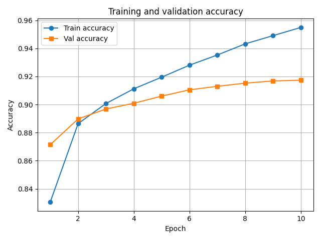
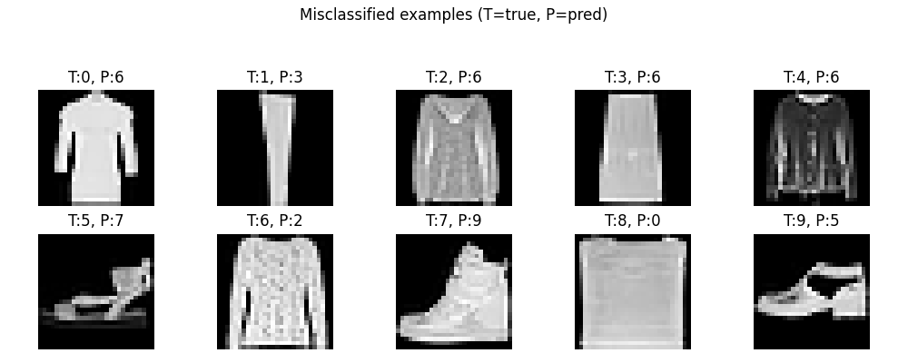

# 1. Model architecture

I trained a convolutional neural network on the Fashion-MNIST dataset using the required architecture:

- Input: 28×28 grayscale image, reshaped to (28, 28, 1)
- 2D convolutional layer, 28 filters, 3×3 kernel, ReLU activation, padding="same"
- 2×2 max pooling
- 2D convolutional layer, 56 filters, 3×3 kernel, ReLU activation, padding="same"
- Flatten
- Fully-connected layer, 56 nodes, ReLU activation
- Fully-connected output layer, 10 nodes, softmax activation

The model has **629,730 trainable parameters** in total.

# 2. Training setup

- Dataset: Fashion-MNIST
- Normalization: pixel values scaled to \[0, 1\]
- Train/validation split:  
  - 60,000 training examples from Keras  
  - First 48,000 used for training  
  - Last 12,000 used as validation set
- Optimizer: Adam (learning rate 3e-4)
- Loss: sparse categorical cross-entropy
- Batch size: 32
- Number of epochs: 10

The table below shows the training and validation accuracy at the end of each epoch:
Directly pasted from the output 
| Epoch | Train accuracy | Val accuracy |
|------:|----------------|--------------|
| 1 | 0.8305 | 0.8714 |
| 2 | 0.8864 | 0.8898 |
| 3 | 0.9007 | 0.8968 |
| 4 | 0.9112 | 0.9009 |
| 5 | 0.9195 | 0.9060 |
| 6 | 0.9281 | 0.9105 |
| 7 | 0.9353 | 0.9130 |
| 8 | 0.9433 | 0.9153 |
| 9 | 0.9491 | 0.9168 |
| 10 | **0.9550** | **0.9173** |

# 3. Training and validation accuracy curves

The following figure shows the training and validation accuracy as a function of epoch.  
The model keeps improving on the training set, while the validation accuracy starts to plateau around 91–92%, which suggests a small amount of overfitting but still good generalization.

# 4. Test set performance

After training, I evaluated the network on the 10,000-image test set:

- **Test loss:** 0.2597  
- **Test accuracy:** **0.9132**

The test accuracy is very close to the validation accuracy, which indicates that the train/validation split was representative and the model generalizes reasonably well.

## 5. Misclassified examples

For each true class, I selected one example from the test set where the model made an incorrect prediction and plotted them in a 2×5 grid. The title of each image shows the true label and the predicted label.

From these examples, many errors occur between visually similar classes, such as T-shirt/top vs. shirt or coat vs. pullover. Some mistakes also happen on low-contrast or ambiguous images where even a human might hesitate.

# 6. Observations about model performance

1 The CNN reaches about **95.5% training accuracy** and **91–92% validation/test accuracy** in only 10 epochs, which is a strong result for this relatively small architecture.
2 The training accuracy is noticeably higher than validation/test accuracy, suggesting mild overfitting. Regularization methods such as dropout, weight decay, or data augmentation (random shifts, small rotations) could help close this gap.
3 Most misclassifications happen between semantically and visually related classes, which indicates that the model has learned meaningful features but still struggles to separate fine-grained differences in clothing shape and texture.
4 The architecture specified in the assignment provides a good trade-off between model size and performance, and the training process is stable when using the Adam optimizer with a modest learning rate.
